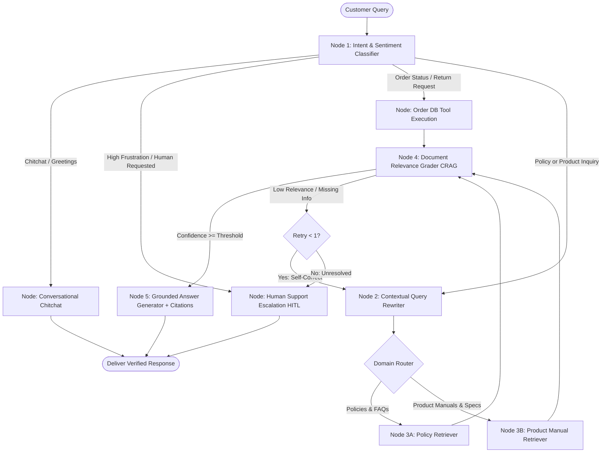

# 🛍️ NovaMart: Intelligent Customer Support Agent
### Built with LangGraph, Self-Corrective RAG (CRAG), and Human-in-the-Loop (HITL)

An enterprise-ready AI customer support agent designed to automate repetitive e-commerce inquiries regarding **product specifications, delivery/shipping policies, returns, warranties, and refunds**. 

Built with a stateful **LangGraph workflow**, the agent classifies intent, resolves multi-turn conversational follow-up questions, retrieves factual knowledge from partitioned policy and manual vector stores, fact-checks retrieved passages before answering, and gracefully escalates complex or low-confidence cases to a human specialist.

---

## 🌟 Key Architecture & Differentiators



### 1. Dual-Source Partitioned Knowledge Base
* **Company Policies (`data/policies/`):** Official rules for Returns & Refunds (30-day window, fees, non-returnables), Shipping & Delivery (tiers, tracking, lost shipment protocol), and Warranties (1-year manufacturer guarantee, exclusions).
* **Product Manuals (`data/manuals/`):** Full technical specs, pairing guides, battery life, and troubleshooting codes for products (e.g., *AuraSound Pro ANC Headphones*, *ApexClean X9 Robot Vacuum*, *ErgoComfort Max Office Chair*).

### 2. Contextual Query Rewriting for Multi-Turn Conversations
* Automatically resolves coreferences and ambiguous pronouns in follow-ups.
* Example:
  * Turn 1: *"Tell me about the AuraSound Pro headphones."*
  * Turn 2: *"Does it support multipoint Bluetooth pairing?"* $\rightarrow$ Rewritten: *"AuraSound Pro AS-900 Does it support multipoint Bluetooth pairing?"*

### 3. Corrective RAG (CRAG) & Hallucination Prevention
* The **`document_grader`** node verifies whether retrieved chunks actually contain the factual proof to answer the question.
* If confidence is below threshold, it triggers an automated query reformulation retry. If still unresolvable, it safely hands off to human support instead of hallucinating.

### 4. Human-in-the-Loop (HITL) Priority Desk
* Escalates automatically when:
  * Customer sentiment indicates severe anger or frustration.
  * Explicit demand for a human supervisor.
  * Knowledge base cannot answer the query with high confidence.
* Generates persistent support tickets (`TICK-XXXXXX`) that appear live in the **Human Support Desk** panel where human agents can review transcripts and respond.

### 5. Live E-Commerce Action Tools
* Integration with mock operational order database (`orders.json`) for:
  * Real-time order tracking (courier, status, estimated delivery).
  * Automated 30-day return eligibility calculator.

---

## 📁 Project Structure

```
intelligent-customer-support/
├── app.py                     # Streamlit 3-panel UI (Chat, Graph Trace, HITL Portal)
├── requirements.txt           # Dependencies
├── .env.example               # Environment template for GEMINI_API_KEY
├── test_workflow.py           # Verification script testing all graph branches
├── data/
│   ├── policies/              # Company policy documents
│   │   ├── return_refund_policy.md
│   │   ├── shipping_delivery_policy.md
│   │   └── warranty_policy.md
│   ├── manuals/               # Product manuals & technical specs
│   │   ├── aurasound_pro_headphones.md
│   │   ├── apexclean_x9_robot_vacuum.md
│   │   └── ergocomfort_max_chair.md
│   └── mock_db/               # Mock orders and escalated ticket storage
│       ├── orders.json
│       └── escalated_tickets.json
└── src/
    ├── config.py              # Thresholds, model names, directory paths
    ├── state.py               # TypedDict SupportAgentState schema
    ├── llm.py                 # Gemini LLM service with JSON parsing & fallback
    ├── retriever.py           # Hybrid Section Chunker & Vector Search engine
    ├── tools.py               # Order tracking, return checks, ticket persistence
    ├── graph.py               # LangGraph StateGraph assembly & compilation
    └── nodes/
        ├── classifier.py      # Intent & Sentiment Classifier
        ├── rewriter.py        # Contextual Query Rewriter for follow-ups
        ├── retrieval_nodes.py # Policy and Manual domain retrievers + tools
        ├── grader.py          # Document Relevance Grader (CRAG)
        ├── generator.py       # Grounded Response Generator with citations
        └── escalation.py      # Human Escalation & Ticket Generator
```

---

## 🚀 Quickstart Guide

### 1. Install Dependencies
```bash
pip install -r requirements.txt
```

### 2. Set Up API Key (Optional)
Create a `.env` file or export your Gemini API key:
```bash
export GEMINI_API_KEY="your_gemini_api_key_here"
```
*(Note: The system includes a built-in Smart Simulation fallback so you can also run, test, and demonstrate the entire LangGraph workflow offline without an API key!)*

### 3. Launch the Interactive Web App
```bash
streamlit run app.py
```
Open your browser to `http://localhost:8501`.

---

## 🧪 Demonstration Test Queries

| Test Case | Example Query | Expected Graph Execution |
| :--- | :--- | :--- |
| **Return Policy** | *"What is the return window and are there return fees?"* | `classifier` $\rightarrow$ `rewriter` $\rightarrow$ `retrieve_policy` $\rightarrow$ `grader` $\rightarrow$ `generator` (Cites Return Policy §1) |
| **Product Specs** | *"What is the battery life and water resistance of the AuraSound Pro?"* | `classifier` $\rightarrow$ `rewriter` $\rightarrow$ `retrieve_product` $\rightarrow$ `grader` $\rightarrow$ `generator` (Cites Manual §1) |
| **Follow-up Context** | *(After asking about AuraSound)* *"Does it support multipoint Bluetooth?"* | Query rewriter resolves `"it"` to `"AuraSound Pro AS-900"` $\rightarrow$ retrieves pairing section |
| **Order Tracking** | *"Where is my order ORD-98214?"* | `classifier` $\rightarrow$ `handle_order_actions` (queries `orders.json`) $\rightarrow$ returns carrier & tracking link |
| **Return Check** | *"Can I return order ORD-76150?"* | Calculates delivery date vs 30-day window $\rightarrow$ confirms return eligibility |
| **Human Escalation** | *"I am furious, give me a real manager now!"* | `classifier` flags `frustrated` sentiment $\rightarrow$ `escalate_to_human` generates priority ticket `TICK-XXXXXX` |
| **Out-of-Domain CRAG** | *"Can you ship a submarine engine to Antarctica tomorrow?"* | Grader scores low confidence $\rightarrow$ CRAG routes to `escalate_to_human` |
